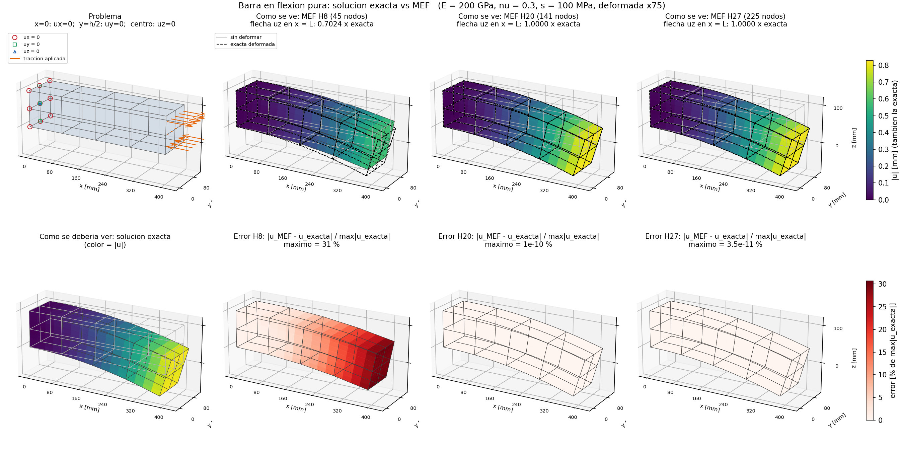
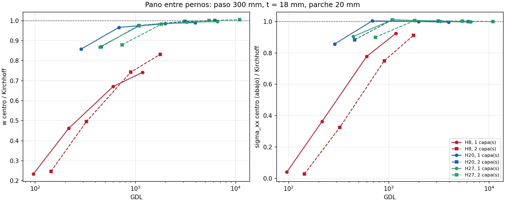

# T4 ICM3323 — MEF 3D del blindaje de acero de un túnel

Elementos finitos 3D (hexaedros H8, H20 y H27) programados desde cero en Python, para analizar el
blindaje de acero (planchas de 18 mm apernadas) de un túnel bajo la presión de filtración por detrás
del blindaje con el túnel vacío.

## Estructura

```
funciones/                  # la librería de MEF, por etapas
  unidades.py               #   registro de unidades (pint)
  etapa1_malla/             #   elementos (caras, validación), mallador estructurado, malla del túnel
  etapa2_interpolacion/     #   funciones de forma H8 / H20 / H27 (y Q4 / Q8 / Q9 para las caras)
  etapa3_matrices/          #   D, puntos de Gauss, B y jacobiano, K global dispersa, fuerzas de presión
  etapa4_resolver/          #   restricciones, solución K U = F dispersa, tensiones, von Mises y simetría
  etapa5_graficar/          #   malla 3D, desarrollo del túnel, curvas de comparación
codigo/
  tunel/problema_tunel.py   # datos del blindaje: carga, pernos, malla (acá se cambia todo)
  tunel/resolver_tunel.py   # arma y resuelve K U = F y guarda resultados/<nombre>.npz
  tunel/analizar_tunel.py   # lee el .npz: tablas (MPa, kN) y figuras de deformada y tensiones
  pruebas/                  # verificación de la implementación (ver abajo)
propuesta/                  # propuesta del trabajo (LaTeX + PDF)
```

Los scripts de `codigo/` agregan `funciones/` al path solos, así que se corren desde cualquier carpeta.

## Instalación

```bash
pip install -r requirements.txt
python3 codigo/tunel/problema_tunel.py    # ver la malla y los pernos
python3 codigo/tunel/resolver_tunel.py    # resolver (con simetría en x = 0 resuelve la mitad)
python3 codigo/tunel/analizar_tunel.py    # analizar el último resultado guardado
```

Los `.npz` de `resultados/` no se suben (pesan decenas de MB); se regeneran con `resolver_tunel.py`.
Las figuras de cada caso sí están en `codigo/tunel/resultados/`.

## Pruebas (`codigo/pruebas/`)

De la más básica a la más completa:

| Script | Qué hace |
|---|---|
| `probar.py` | Menú para probar cada función de a una viendo qué entra y qué sale (`python3 probar.py matriz_D`, `... todas`). |
| `verificar_elemento.py` | Revisiones de H8 / H20 / H27 distorsionados: δᵢⱼ, partición de la unidad, derivadas vs diferencias finitas, patch test, rotación rígida, volumen, 6 modos de energía nula, fuerzas de presión. |
| `verificar_viga.py` | Voladizo de plancha delgada con un elemento en el espesor vs Euler-Bernoulli: muestra el shear locking del H8. |
| `viga_cuadrada.py` | Misma viga maciza como sólido 3D H20 y como elementos de viga de Hermite, vs Euler-Bernoulli y Timoshenko. |
| `cubo_3d.py` | Comparación 3D exacta vs MEF en todo el sólido: cubo a tracción (patch test) y barra en flexión pura (Saint-Venant). |
| `comparar_elementos.py` | Paño de plancha entre pernos vs Kirchhoff (serie de Fourier), perno como rótula vs parche, y sensibilidad a la distorsión. |

`casos_3d.py` y `soluciones_placa.py` son módulos de apoyo (casos 3D armados y soluciones analíticas).

### Algunos resultados

Flexión pura: el H8 se traba (flecha 0.70 de la exacta); H20 y H27 dan exacto.



Paño entre pernos vs Kirchhoff al refinar la malla:



## Referencias

Los datos del problema salen del informe de cálculo Voith 1530-VOI-320-0-CC-0072 (cap. 8) y de los
planos 2MHS08-0100 / 0101. Esos documentos no se incluyen en el repositorio.
